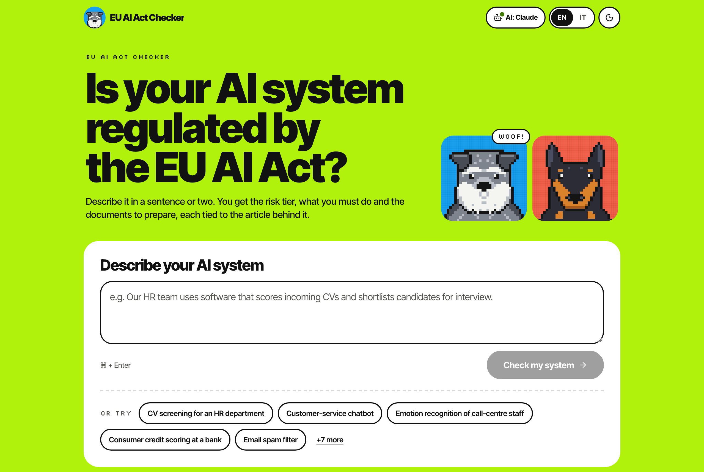
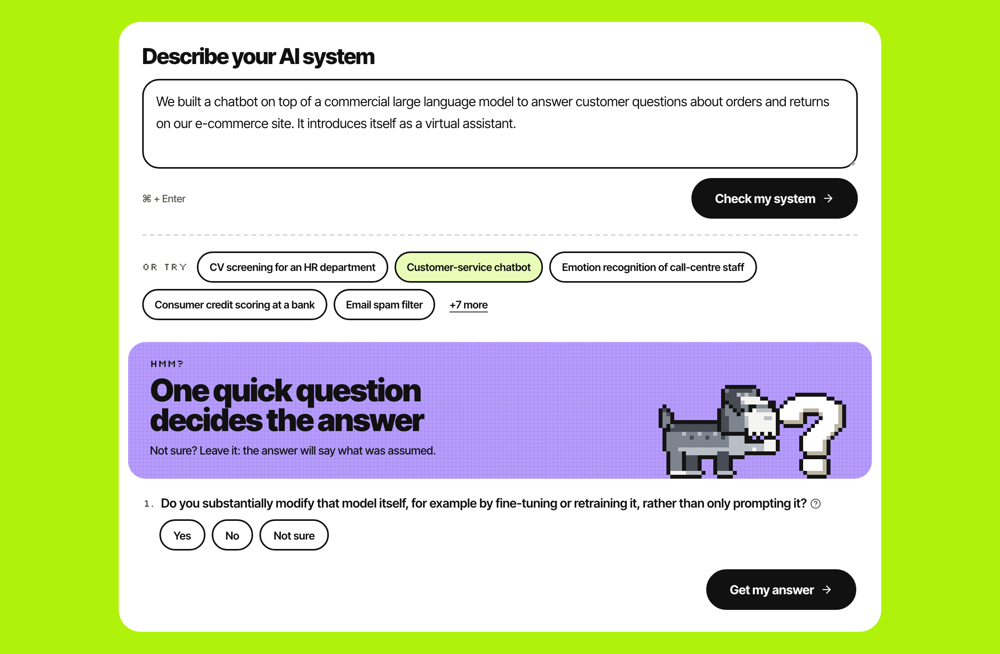
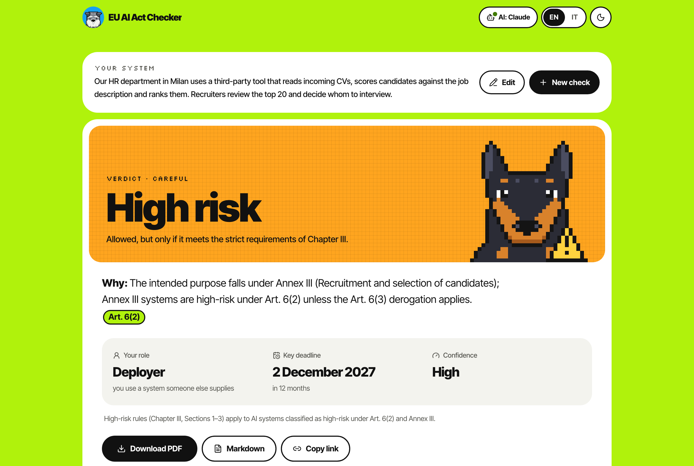
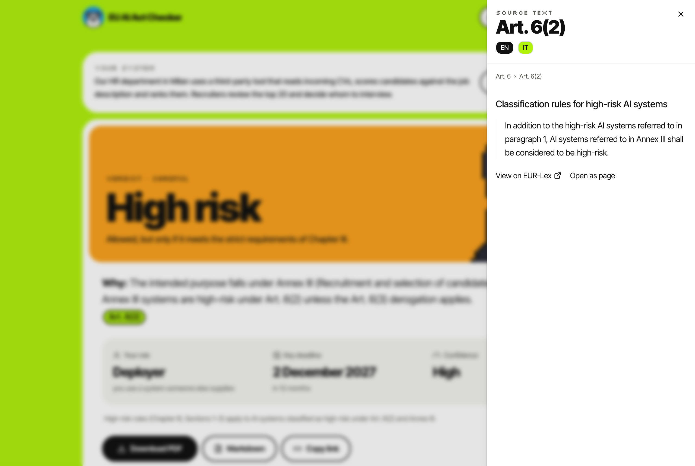
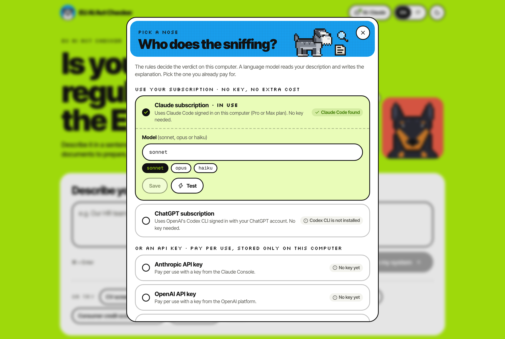
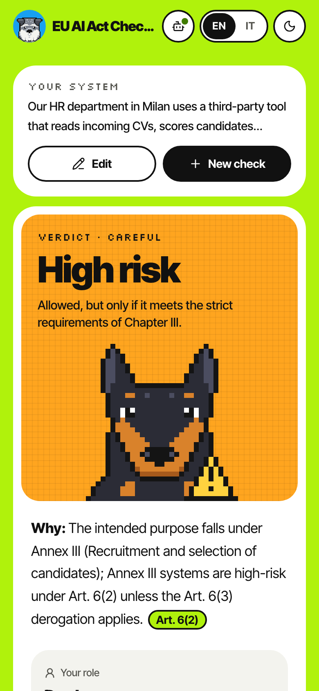
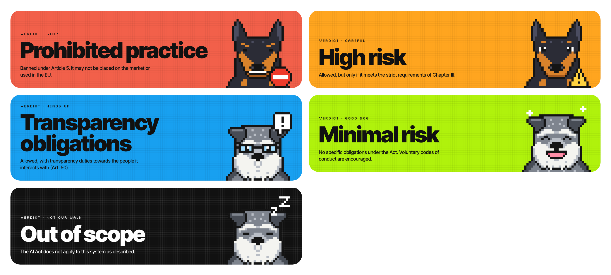
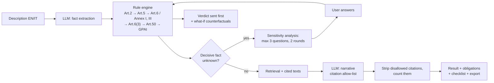
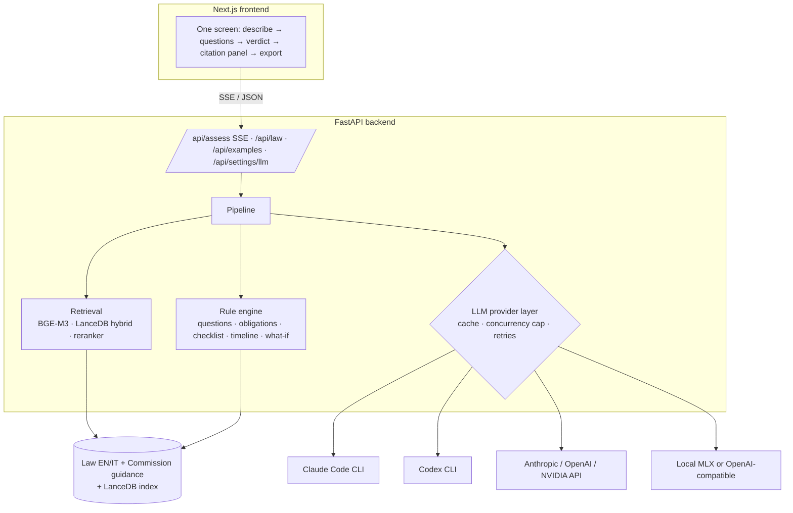

# EU AI Act Checker

**Describe an AI system in plain language and get, in about ten seconds, its risk tier under the EU AI Act, what your company must do about it, and the exact article behind every claim.**

A local-first web app for founders, product teams and in-house counsel who build or buy AI in the EU. English and Italian, law as of 27 July 2026 (including the Digital Omnibus on AI).


[Watch the full demo (MP4, 54 s)](docs/media/demo.mp4): example, follow-up question, verdict, citation, obligations, documents, "what would change the answer", cited reasoning, dark mode.

## Why it matters

Every company that builds or deploys AI in the EU has to know which tier of the AI Act its system falls into, because the tier decides everything that follows: a ban, a full conformity regime, a transparency duty, or nothing. Getting it wrong is expensive. Fines reach EUR 35 million or 7% of worldwide annual turnover, whichever is higher, for prohibited practices, and EUR 15 million or 3% for breaching the obligations of providers and deployers (Art. 99).

The answer is hard to find. The consolidated text runs to 119 articles, 14 annexes and 180 recitals. The rules are spread across prohibitions, high-risk categories, exceptions to those categories and duties that differ by role. In July 2026 the Digital Omnibus (Regulation (EU) 2026/1744) moved the deadlines and added new prohibitions, so much of what was written about the Act in 2024 and 2025 is now out of date. Today a first answer means a specialist reading the text, or a generic chatbot that sounds confident and cites articles that may not say what it claims.

This tool gives that first answer in seconds. It cites a real provision for every claim and says what it assumed. On a labelled test set of 56 cases:

- **54 of 56 tiers are correct (96%)**, and no system is placed in a lower tier than it should be. That is the dangerous error, and the rate is 0%.
- **Every citation points to a real, allowed provision**, and it covers 84% of the provisions a reviewer would expect, against 49% for the same model answering on its own.
- **About 10 seconds and 3 cents per assessment** with Claude Sonnet, or free and fully offline with a local model, at lower accuracy.

It orients; it does not replace a lawyer. The "not legal advice" notice and the "law as of" date are on every screen and in every export.

## See it in action

| | |
|---|---|
|  |  |
| **Describe it**, or start from one of twelve examples. | **One question, only if it changes the answer.** "Not sure" is always allowed. |
|  |  |
| **The verdict**: tier, your role, the deadline that applies, and why, with the article. | **Every citation opens the source text**, in English or Italian, with a link to EUR-Lex. |
|  |  |
| **Pick the model**: a Claude or ChatGPT subscription, an API key, or a local model. | **Works on a phone**, with a dark mode ([dark screenshot](docs/screenshots/result-mobile-dark.png)). |

Each tier has its own colour and pixel-art dog: a doberman guards the rules, a schnauzer reads and explains.



More: [full result page](docs/screenshots/result-full.png), [landing in dark mode](docs/screenshots/landing-dark.png), [sample exported assessment (PDF)](docs/samples/assessment-sample.pdf).

## How it works

1. **You describe the system** in a sentence or two, in English or Italian.
2. **A language model turns the description into facts**: what the system does, who uses it, on whom, whether a person makes the final decision. It does not decide anything. Facts it cannot find stay "unknown".
3. **Hand-written rules decide the tier** from those facts, in the order the Act applies them: scope (Art. 2), prohibitions (Art. 5), high-risk categories (Art. 6 with Annex I and III), the exception to high risk (Art. 6(3)), transparency (Art. 50) and general-purpose models.
4. **If a missing fact would change the outcome, you get a question.** There are at most three questions, and only for facts that change the tier or the obligations.
5. **The verdict appears as soon as the rules decide.** It shows the obligations for your role, each with its article, the documents to prepare, and the answers that would move the system into another tier.
6. **The model then writes the explanation**, but it may only cite provisions from an approved list. The server removes any other citation before you see it.
7. **Export** to PDF or Markdown, or share a link.





## Results

A labelled test set ([`eval/cases.yaml`](eval/cases.yaml)) and a reproducible runner compare the hybrid design with a plain "LLM plus retrieved provisions" baseline. That way the value of the rule engine is measured, not asserted. Full report: [`eval/REPORT.md`](eval/REPORT.md).

**Test set:** 56 cases. 25 cover Annex III (one per point or letter), 4 cover Art. 5, 8 are taken from Commission guidance, 15 are edge cases, 2 are GPAI and 2 are Art. 50. Seven are in Italian and seven need a clarifying question. Labels follow the consolidated text of 27 July 2026. Where the text is ambiguous, the label takes the stricter reading and says so ([`eval/README.md`](eval/README.md)).

| Configuration | Tier accuracy | Under-classified | Asked when needed | Citation validity | Citation recall | p50 latency (uncached) | Cost / assessment |
|---|---|---|---|---|---|---|---|
| hybrid · Claude Sonnet (CLI) | 54/56 (96%) | 0% | 57% | 100% (by construction) | 84% | 10 s | $0.030 |
| hybrid · Qwen2.5-14B-Instruct-4bit (local) | 48/56 (86%) · 1 error | 7% | 71% | 100% (by construction) | 72% | 61 s | $0 (local) |
| hybrid · Qwen2.5-3B-Instruct-4bit (local) | 42/56 (75%) · 2 errors | 14% | 29% | 100% (by construction) | 52% | 17 s | $0 (local) |
| baseline (pure LLM + RAG) · Claude Sonnet | 53/56 (95%) | 2% | n/a | 100% | 49% | 8 s | $0.011 |
| baseline · Qwen2.5-14B | 39/56 (70%) | 12% | n/a | 96% | 17% | 12 s | $0 (local) |

How to read it:

- **Tier accuracy and under-classification are measured end to end.** The LLM extracts the facts and the rules decide. When the engine asks a question, the runner answers it from the labelled facts (an "oracle user"). The figures therefore measure fact extraction plus question selection, not unaided accuracy. Runs that fail for infrastructure reasons count as wrong and are also listed as errors.
- **Under-classified** is the share of cases placed in a less severe tier than the label (out of scope < minimal < limited < high risk < prohibited). This is the error that matters most.
- **Citation validity is 100% for the hybrid pipeline by construction.** Engine citations come from a hand-checked list, and narrative citations outside the allow-list are stripped. It is shown only to contrast with the baseline, where the model cites freely. For the hybrid pipeline the informative figures are **citation recall** (share of the labelled key provisions that appear) and the count of stripped citations in the report. "Valid" means the provision exists and was allowed, not that it supports the sentence.
- **Asked when needed** is the share of the seven `should_ask` cases where at least one question was asked.
- **Cost** is the API-equivalent figure reported by the Claude CLI, which bills to a subscription, not per call. Local models ran on an Apple M4 Max.
- **Provenance.** The Claude rows and the 14B rows use the final engine. The 3B row predates the last question-gating fix and was not re-run, so its "asked when needed" figure is pessimistic.
- A separate deterministic check (`eval/validate_cases.py` plus the engine run on the labelled facts) gives 56/56. It is circular, because the same project wrote the labels and the rules, so it is a consistency test, not an accuracy figure.

Reproduce (writes `eval/results/<timestamp>-<config>.json` and regenerates `eval/REPORT.md`):

```bash
backend/.venv/bin/python eval/validate_cases.py            # schema + citations check
backend/.venv/bin/python eval/run_eval.py --config all     # the five configurations above
backend/.venv/bin/python eval/run_eval.py --config hybrid:claude_cli:sonnet --limit 5
backend/.venv/bin/python eval/run_eval.py --report-only
```

## Key design decisions

- **The model reads; the rules decide.** A language model is good at turning messy prose into structured facts and bad at applying a legal test the same way twice. So the LLM only fills a fact sheet, and a deterministic rule engine, written by hand from the text of the Act, decides the tier. The same facts always give the same verdict, and every step of the decision has an article attached. Against the same model answering on its own, this mainly buys safety and traceability: under-classification drops from 2% to 0% and citation recall rises from 49% to 84%, at similar accuracy.
- **Ask only the questions that change the answer.** For each unknown fact, the engine tries every possible value and checks whether the tier or the obligations change. Only those facts become questions, ranked by how much uncertainty they remove, with at most three per round. "What would change the answer" uses the same engine in reverse. It never changes the verdict; it shows which answers would.
- **Citations are checked, not trusted.** The narrative may cite only provision IDs from an allow-list: the engine's findings, the obligations and the retrieved passages. The server checks every citation token and strips the rest. Prose mentions such as "Article 6(3)" become verified links only when they resolve to an allowed provision. The limit is stated openly: the guard proves that a citation exists and is allowed, not that it supports the sentence.
- **When in doubt, the stricter reading.** Where the Act is ambiguous, the engine picks the more severe outcome and says so, and unknown scope facts are recorded as "assumed in scope" rather than silently excluded. Over-classifying costs a second look; under-classifying can cost a fine.
- **Local-first and model-agnostic.** The law, the index, embeddings and reranking all run on the user's machine. Descriptions are not stored anywhere except a local response cache. The LLM is a swappable provider, so the same product runs on a Claude or ChatGPT subscription, a pay-per-use API or a free local model. The evaluation shows what each choice costs in accuracy.

## What I'd build next

- Run the 3B configuration again on the final engine, and add per-tier metrics and a blind second labeller to break the circularity of the label set.
- Better scope detection: the two cases Claude still gets wrong are both "is this in scope at all?" (a US-only service and a research-only prototype).
- Update automatically when the final Art. 6 classification guidelines are adopted (now a May 2026 draft).
- A hosted version with authentication and rate limiting, and saved assessments a team can review together.

## About

Built by **Costantino Zunino** ([LinkedIn](https://www.linkedin.com/in/costantinozunino)).

I designed the product, the legal rules, the test set and the evaluation, and built it with Claude Code as an AI pair-programmer.

---

## Run it locally

Prerequisites: macOS on Apple Silicon or Linux; [`uv`](https://docs.astral.sh/uv/); Node 20 or later with `pnpm`; and, for the default provider, the Claude Code CLI installed and logged in (`claude`).

```bash
./start.sh
```

Then open http://localhost:3101. On first run the script:

1. creates `.env` from `.env.example` if missing;
2. creates the Python 3.12 environment with `uv sync`;
3. fetches the law from the Publications Office (Cellar) if `data/raw` lacks it, and builds `data/corpus/{en,it}.json` and the guidance corpus;
4. downloads the embedding and reranking models into `data/models` (about 4.6 GB: BGE-M3 and bge-reranker-v2-m3);
5. builds the LanceDB index in `data/index`;
6. installs the frontend dependencies and starts both servers.

Ports: frontend 3101, backend 8101 (override with `FRONTEND_PORT` and `API_PORT`). `./start.sh --setup` only prepares everything; `--backend` and `--frontend` start one side.

Frontend only, with a mock API (no backend, no model):

```bash
cd frontend && NEXT_PUBLIC_MOCK_API=1 pnpm dev
```

Tests:

```bash
backend/.venv/bin/python -m pytest backend/tests -q
cd frontend && pnpm lint && pnpm exec tsc --noEmit && pnpm exec playwright test   # e2e runs against the mock API
```

Tests marked `live` call a real model and run only with `LIVE_LLM=1`.

Screenshots and the demo are produced with the project's own Playwright scripts against a running app: `frontend/scripts/capture_screenshots.mjs` and `frontend/scripts/record_demo.mjs` (the ffmpeg commands for the MP4 and GIF are in its header). Both use bundled examples, so with `LLM_CACHE=1` a repeated run replays cached responses.

## Switching the LLM provider

The easiest way is the **AI pill in the header** (a robot icon on phones). It opens "Who does the sniffing?", where you pick a Claude subscription (Claude Code), a ChatGPT subscription (Codex CLI), an Anthropic, OpenAI or NVIDIA API key, or the local model. Each option shows whether it is ready. If a CLI is missing, it shows the install and login commands to copy. Each option also has a model field with suggestions, plus **Save**, **Test** (one tiny prompt, not cached) and **Use this**. The choice takes effect on the next request, with no restart. It is saved to `data/llm_settings.json` (gitignored, mode 600) and overrides `.env`. Keys are write-only: the API only ever returns a masked hint such as `sk-…abcd`. The endpoints are `GET`/`PUT /api/settings/llm` and `POST /api/settings/llm/test/{provider}`.

Or set `LLM_PROVIDER` and that provider's model variable in `.env`. The older `LLM_MODEL` still works and applies to the provider named in `LLM_PROVIDER`. Embeddings and reranking always run locally, whatever the provider.

| `LLM_PROVIDER` | Needs | Model variable (default) | Notes |
|---|---|---|---|
| `claude_cli` (default) | Claude Code CLI logged in; `CLAUDE_CLI_PATH` if not on `PATH`. No API key. | `CLAUDE_CLI_MODEL` (`sonnet`; also `opus`, `haiku`) | Runs `claude -p` headless on your subscription, with `--tools ""`, `--no-session-persistence`, `--setting-sources ""`, `--strict-mcp-config`, a `--system-prompt`, the prompt on stdin, and `json` or `stream-json` output. |
| `codex_cli` | OpenAI Codex CLI (`npm install -g @openai/codex`, then `codex login` with your ChatGPT account); `CODEX_CLI_PATH` | `CODEX_MODEL` (empty = Codex default) | Runs `codex exec --skip-git-repo-check --sandbox read-only --ephemeral --output-last-message FILE -` in an empty temp folder, with the system text leading the prompt on stdin. No token streaming. |
| `anthropic_api` | `ANTHROPIC_API_KEY` | `ANTHROPIC_MODEL` (`claude-sonnet-5-5`; or `claude-opus-5-5`) | Direct Messages API, per-token billing; use this or `nvidia` on a server, where the CLI cannot run. |
| `openai_api` | `OPENAI_API_KEY` | `OPENAI_MODEL` (none; pick one) | OpenAI platform (`https://api.openai.com/v1`), JSON mode, `max_completion_tokens`. |
| `nvidia` | `NVIDIA_API_KEY` (free catalogue at build.nvidia.com); `NVIDIA_BASE_URL` | `NVIDIA_MODEL` (`meta/llama-3.3-70b-instruct`) | OpenAI-compatible endpoint. |
| `local_mlx` | Apple Silicon; weights via `backend/.venv/bin/python scripts/download_models.py --llm-only` | `MLX_MODEL` (`mlx-community/Qwen2.5-14B-Instruct-4bit`), `MLX_SMALL_MODEL` | In-process via mlx-lm; no network, no key. |
| `openai_compat` | `OPENAI_BASE_URL` (default `http://localhost:8080/v1`), optional `OPENAI_COMPAT_API_KEY` | `OPENAI_COMPAT_MODEL` (or `LLM_MODEL`) | llama-server, vLLM or any OpenAI-compatible server. Set in `.env` only; not shown in the picker. |

Shared behaviour: responses are cached in SQLite (`LLM_CACHE=1`, `LLM_CACHE_PATH=data/cache/llm.sqlite`), keyed on a hash of provider, model, prompt and parameters, so repeated runs replay instantly. `LLM_MAX_CONCURRENCY` (default 2) caps parallel calls, which matters for the rate-limited CLI. Retryable errors (network, HTTP 408/429/5xx, overloaded) are retried with backoff; the request timeout is `LLM_TIMEOUT_S` (default 180).

## API

| Endpoint | What it does |
|---|---|
| `POST /api/assess` | Server-sent events: `stage`, `facts`, `questions` or `verdict`, `token` (narrative), `result`, `done`, `error`. Send the answers and `round` back to continue after questions. |
| `POST /api/export/pdf`, `POST /api/export/markdown` | Export an assessment. |
| `GET /api/law/{id}?lang=en\|it`, `GET /api/law/search` | The text of one provision (for example `art:6.2`, `annex:III`), with its breadcrumb and EUR-Lex link; search over the law and guidance. |
| `GET /api/examples?lang=` | The twelve bundled examples. |
| `GET`/`PUT /api/settings/llm`, `POST /api/settings/llm/test/{provider}` | The model picker. |
| `GET /api/meta`, `GET /health` | Law date, amending acts and timeline; provider, model and corpus status. |

Full request and response shapes: [`docs/CONTRACTS.md`](docs/CONTRACTS.md).

## Legal baseline and sources

- **Text:** consolidated version `02024R1689-20260727` (EN and IT), fetched from the Publications Office Cellar. It includes Regulation (EU) 2026/1744 (Digital Omnibus on AI, in force 27 July 2026), whose amendments are kept as metadata (`REPLACED | INSERTED | DELETED`). Recitals come from the original OJ text, because consolidations omit the preamble. What the Omnibus changed: [`docs/omnibus-2026-1744.md`](docs/omnibus-2026-1744.md). How the rules map to the text: [`docs/legal-logic.md`](docs/legal-logic.md).
- **Application timeline** (Art. 113 as amended):

| Date | What applies |
|---|---|
| 2 Feb 2025 | Chapters I-II: definitions and Art. 5 prohibitions (except the new points below) |
| 2 Aug 2025 | GPAI obligations, governance, penalties provisions (Chapter III Section 4, Chapters V, VII, XII, Art. 78) |
| 2 Aug 2026 | General application, including Art. 50 transparency |
| 2 Dec 2026 | New Art. 5(1)(ba), (bb), 5(1a), 5(1b); end of the Art. 50(2) marking grace period for systems placed on the market before 2 Aug 2026 (Art. 111(4)) |
| 2 Dec 2027 | High-risk systems under Annex III |
| 2 Aug 2028 | High-risk systems under Annex I (products) |

- **Commission guidance used** (non-binding; details and URLs in [`docs/guidance-sources.md`](docs/guidance-sources.md)):

| Document | Status |
|---|---|
| Guidelines on the definition of an AI system, C(2025) 924 | final (6 Feb 2025) |
| Guidelines on prohibited AI practices, C(2025) 884 | final (4 Feb 2025) |
| Guidelines on obligations of GPAI model providers, C(2025) 5045 | final (18 Jul 2025) |
| Guidelines on classification of high-risk systems (Art. 6) | **draft** (19 May 2026; final expected by end of 2026) |
| Guidelines on Art. 50 transparency, C(2026) 5054 | final (20 Jul 2026) |
| Code of Practice on marking and labelling AI-generated content | final, voluntary (10 Jun 2026) |
| Commission news item "AI Omnibus enters into force"; AI Act Service Desk Omnibus FAQ | informational (the FAQ describes the proposal, not the adopted text) |

## Project layout

```
ai-act-checker/
  start.sh  .env.example  LICENSE
  backend/            FastAPI app (uv project, Python 3.12)
    app/corpus/       parser and store for the EUR-Lex XHTML
    app/engine/       facts, rules, questions, obligations, checklist, timeline, what-if
    app/llm/          provider layer, cache, limits, JSON repair, saved model choice
    app/retrieval/    chunking, BGE-M3 embeddings, LanceDB index, reranker, search
    app/prompts/      extraction, narrative, baseline prompts
    app/api/          routes (SSE) and export endpoints
    app/export/       Markdown and PDF
    tests/
  frontend/           Next.js (App Router), Tailwind v4, shadcn/ui; Playwright e2e in e2e/
    src/components/pixel/   the dog sprites, drawn as 32x32 character maps rendered as SVG rects
    scripts/          screenshot and demo recording scripts
  eval/               cases.yaml, run_eval.py, validate_cases.py, REPORT.md, results/
  scripts/            fetch_law, build_corpus, build_guidance, build_index, download_models, probe_retrieval
  data/               raw/ (downloaded sources), corpus/, guidance/, index/, models/
  docs/               CONTRACTS.md, legal-logic.md, omnibus-2026-1744.md, guidance-sources.md, deploy.md, media/, screenshots/
```

## Limits and honest caveats

- It is an orientation tool, not a conformity assessment or legal advice.
- The rule engine encodes one conservative reading of the text. Where the Act is ambiguous, it picks the stricter outcome and says so; the eval notes list the known ambiguities (`eval/README.md`).
- The test set and the rules were written by the same person. The end-to-end figures depend on the LLM's fact extraction, so they are not circular, but the labels have not been reviewed by a second lawyer.
- The Art. 6 classification guidelines are a draft (May 2026) and may change before adoption. Cases that rely on them are flagged.
- The Italian narrative is only as good as the model behind it; the legal text itself is the official Italian version.
- Small local models are weaker at fact extraction: 48/56 for Qwen2.5-14B and 42/56 for Qwen2.5-3B against 54/56 for Claude Sonnet, with under-classification rising from 0% to 7% and 14%. The 3B model also fails to produce valid JSON on a few cases. The 14B model is slow on a laptop (p50 61 s).
- Scope exclusions are only as good as the description. The two cases Claude still gets wrong are a US-only service with no EU link and a research-only prototype: the extractor did not flag the Art. 2 exclusion, and the engine records "assumed in scope" rather than asking. Say explicitly where the system is used and whether it is on the market.
- No accounts and no persistence: descriptions are not stored (apart from the local LLM cache on your machine).
- Intended for local use or a sandbox demo; it has no authentication or rate limiting. A written, untested deployment plan (Vercel frontend, container backend, optional Supabase/pgvector) is in [`docs/deploy.md`](docs/deploy.md).

## Licence and attribution

Code: MIT ([`LICENSE`](LICENSE)). Legal text: © European Union, reused under Commission Decision 2011/833/EU; the Commission guidance documents are reused under the same decision. Guidance is interpretive and does not bind courts or authorities; the app labels it as such. The pixel-art mascots are original and drawn in code.
