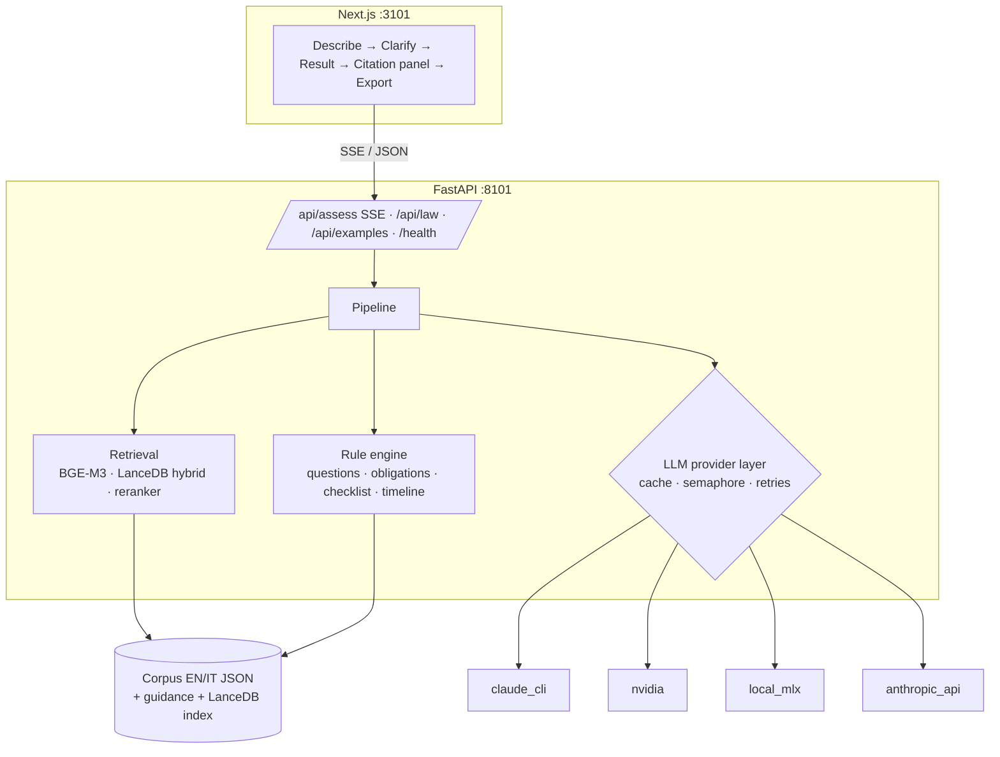

# EU AI Act Checker

Describe an AI system in plain language, answer only the questions that change the outcome, and get its risk tier under Regulation (EU) 2024/1689, the obligations for your role, and a citation to the exact article, annex or recital behind every claim.

Local-first · EN/IT · law as of 27 July 2026

## The problem

Every company that builds or deploys AI in the EU has to know which tier its system falls into and what follows from it. The answer sits in a text of more than 1,600 provisions (119 articles, 14 annexes, 180 recitals in the consolidated corpus), spread across prohibitions, high-risk categories, exceptions and role-specific duties. In July 2026 the Digital Omnibus on AI (Regulation (EU) 2026/1744) moved the application dates and added new prohibitions, so much of what was written about the Act in 2024 and 2025 is out of date. This project gives a first, citable orientation in minutes rather than days.

## What it does

1. Takes a free-text description of an AI system, in English or Italian.
2. Extracts structured facts from it (purpose, sector, who is affected, role, exceptions).
3. Classifies the system: out of scope, prohibited, high-risk, limited risk (Art. 50) or minimal risk, plus GPAI and transparency overlays.
4. Asks at most three clarifying questions per round (two rounds), and only about facts that would change the result.
5. Lists the obligations for your role (provider, deployer or both) and a documentation checklist.
6. Cites the exact provision for every claim; each citation opens the law text in a side panel, in the chosen language. Guidance is labelled non-binding.
7. Exports the assessment to Markdown and PDF, with a "not legal advice" notice, a confidence level, the unresolved assumptions and the "law as of" date.

## Demo


| Landing with the examples gallery | Result with the tier, reasoning and citations |
|---|---|
|  |  |

| Clarifying question | Citation panel with the provision text | Mobile |
|---|---|---|
|  |  |  |

Screenshots are produced by `frontend/scripts/capture_screenshots.mjs` and the GIF by `frontend/scripts/record_demo.mjs` against the running app.

## How it decides

The design is neuro-symbolic: the language model reads and writes, but a deterministic rule engine decides.

- **The LLM extracts facts.** A schema-guided prompt turns the description into a `FactSheet` (`backend/app/engine/facts.py`). Unknown stays unknown; the engine tolerates partial sheets.
- **A rule engine decides the tier.** The rules are authored by hand from the text of the Act, in the order Art. 2 scope, Art. 5, Art. 6 with Annex I and III, the Art. 6(3) derogation, Art. 50, GPAI. Every rule carries its citations, so the provisions behind a tier decision come from a hand-checked list, not from the model.
- **Questions come from sensitivity analysis.** For each unknown fact the engine checks whether the tier, or the set of obligations, changes across its possible values. Only facts that change the outcome are asked, ordered by how much uncertainty they remove.
- **The narrative is constrained.** A second LLM call writes the explanation, but it may cite only provision IDs from an allow-list (the engine's findings, the obligations and retrieved passages). The server checks every citation token against that list and strips the rest; prose mentions such as "Article 6(3)" are turned into verified links when they resolve to an allowed provision and counted as unverified references when they do not. The guard checks that a cited provision exists and is allowed; it does not prove that the provision supports the sentence it is attached to.
- **Retrieval** (BGE-M3 vectors plus full-text search in LanceDB, then a bge-reranker-v2-m3 cross-encoder) supplies related provisions. The binding Regulation and the non-binding guidance are searched separately, because guidance chunks otherwise crowd out the law.

```mermaid
flowchart LR
  D[Description EN/IT] --> F[LLM: fact extraction]
  F --> E[Rule engine<br/>Art.2 → Art.5 → Art.6 / Annex I, III<br/>→ Art.6(3) → Art.50 → GPAI]
  E --> S{Decisive fact<br/>unknown?}
  S -- yes --> Q[Sensitivity analysis:<br/>max 3 questions, 2 rounds]
  Q --> U[User answers] --> E
  S -- no --> R[Retrieval + cited texts]
  R --> N[LLM: narrative<br/>citation allow-list]
  N --> V[Strip disallowed citations,<br/>count them]
  V --> O[Result + obligations<br/>+ checklist + export]
```



## Evaluation

A labelled test set (`eval/cases.yaml`) and a reproducible runner compare the hybrid pipeline with a pure "LLM + retrieved provisions" baseline, so the value of the rule engine is measured rather than asserted.

**Test set:** 56 cases: 25 Annex III (one per point or letter), 4 Art. 5, 8 taken from Commission guidance, 15 edge cases, 2 GPAI, 2 Art. 50. Seven are in Italian and seven require a clarifying question. Labels follow the consolidated text of 27 July 2026; ambiguous cases take the stricter reading and say so in their notes. Details and known ambiguities: `eval/README.md`.

| Configuration | Tier accuracy | Under-classified | Asked when needed | Citation validity | Citation recall | p50 latency | Cost / assessment |
|---|---|---|---|---|---|---|---|
| hybrid · Claude Sonnet (CLI) | TBD | TBD | TBD | TBD | TBD | TBD | TBD |
| hybrid · Qwen2.5-14B-Instruct-4bit (local) | TBD | TBD | TBD | TBD | TBD | TBD | TBD |
| hybrid · Qwen2.5-3B-Instruct-4bit (local) | TBD | TBD | TBD | TBD | TBD | TBD | TBD |
| baseline (pure LLM+RAG) · Claude Sonnet | TBD | TBD | TBD | TBD | TBD | TBD | TBD |
| baseline · Qwen2.5-14B | TBD | TBD | TBD | TBD | TBD | TBD | TBD |

Metric definitions:

- **Tier accuracy**: exact match of the risk tier with the label.
- **Under-classified**: share of cases where the predicted tier is less severe than the label (order: out of scope < minimal < limited < high-risk < prohibited). This is the dangerous error.
- **Asked when needed**: share of the `should_ask` cases where at least one clarifying question was asked.
- **Citation validity**: share of cited IDs that resolve to a real provision in the corpus.
- **Citation recall**: share of the labelled key provisions that appear in the answer.
- **p50 latency**: median wall time per assessment, including all LLM calls and question rounds.
- **Cost / assessment**: API-equivalent USD reported by the Claude CLI (billed to a subscription, not per call); zero marginal cost for local models, with the hardware noted in the report.

Reproduce (writes `eval/results/<timestamp>-<config>.json` and regenerates `eval/REPORT.md`):

```bash
backend/.venv/bin/python eval/validate_cases.py            # schema + citations check
backend/.venv/bin/python eval/run_eval.py --config all     # the five configurations above
backend/.venv/bin/python eval/run_eval.py --config hybrid:claude_cli:sonnet --limit 5
backend/.venv/bin/python eval/run_eval.py --report-only
```

## Legal baseline and sources

- **Text:** consolidated version `02024R1689-20260727` (EN and IT), fetched from the Publications Office Cellar. It includes Regulation (EU) 2026/1744 (Digital Omnibus on AI, in force 27 July 2026), whose amendments are kept as metadata (`REPLACED | INSERTED | DELETED`). Recitals come from the original OJ text, because consolidations omit the preamble. What the Omnibus changed: `docs/omnibus-2026-1744.md`.
- **Application timeline** (Art. 113 as amended):

| Date | What applies |
|---|---|
| 2 Feb 2025 | Chapters I-II: definitions and Art. 5 prohibitions (except the new points below) |
| 2 Aug 2025 | GPAI obligations, governance, penalties provisions (Chapter III Section 4, Chapters V, VII, XII, Art. 78) |
| 2 Aug 2026 | General application, including Art. 50 transparency |
| 2 Dec 2026 | New Art. 5(1)(ba), (bb), 5(1a), 5(1b); end of the Art. 50(2) marking grace period for systems placed on the market before 2 Aug 2026 (Art. 111(4)) |
| 2 Dec 2027 | High-risk systems under Annex III |
| 2 Aug 2028 | High-risk systems under Annex I (products) |

- **Commission guidance used** (non-binding; details and URLs in `docs/guidance-sources.md`):

| Document | Status |
|---|---|
| Guidelines on the definition of an AI system, C(2025) 924 | final (6 Feb 2025) |
| Guidelines on prohibited AI practices, C(2025) 884 | final (4 Feb 2025) |
| Guidelines on obligations of GPAI model providers, C(2025) 5045 | final (18 Jul 2025) |
| Guidelines on classification of high-risk systems (Art. 6) | **draft** (19 May 2026; final expected by end of 2026) |
| Guidelines on Art. 50 transparency, C(2026) 5054 | final (20 Jul 2026) |
| Code of Practice on marking and labelling AI-generated content | final, voluntary (10 Jun 2026) |
| Commission news item "AI Omnibus enters into force"; AI Act Service Desk Omnibus FAQ | informational (the FAQ describes the proposal, not the adopted text) |

- **Reuse:** EU legal texts are reused under Commission Decision 2011/833/EU. Guidance is interpretive and does not bind courts or authorities; the app labels it as such.
- **Not legal advice.** The tool orients; it does not replace a lawyer. The notice appears in the UI and in every export.

## Run it locally

Prerequisites: macOS on Apple Silicon or Linux; [`uv`](https://docs.astral.sh/uv/); Node 20 or later with `pnpm`; and, for the default provider, the Claude Code CLI installed and logged in (`claude`).

```bash
./start.sh
```

Then open http://localhost:3101. On first run the script:

1. creates `.env` from `.env.example` if missing;
2. creates the Python 3.12 environment with `uv sync`;
3. fetches the law from Cellar if `data/raw` lacks it, and builds `data/corpus/{en,it}.json` and the guidance corpus;
4. downloads the embedding and reranking models into `data/models` (about 4.6 GB: BGE-M3 and bge-reranker-v2-m3);
5. builds the LanceDB index in `data/index`;
6. installs the frontend dependencies and starts both servers.

Ports: frontend 3101, backend 8101 (override with `FRONTEND_PORT` and `API_PORT`). `./start.sh --setup` only prepares everything; `--backend` and `--frontend` start one side.

Frontend without a backend (mock API):

```bash
cd frontend && NEXT_PUBLIC_MOCK_API=1 pnpm dev
```

Tests:

```bash
backend/.venv/bin/python -m pytest backend/tests -q
cd frontend && pnpm exec playwright test
```

Tests marked `live` call a real model and run only with `LIVE_LLM=1`.

## Switching the LLM provider

Set `LLM_PROVIDER` (and `LLM_MODEL`) in `.env`. Embeddings and reranking always run locally, whatever the provider.

| `LLM_PROVIDER` | Needs | Example `LLM_MODEL` | Notes |
|---|---|---|---|
| `claude_cli` (default) | Claude Code CLI logged in; `CLAUDE_CLI_PATH` if not on `PATH`. No API key. | `sonnet`, `opus`, `haiku` | Runs `claude -p` headless on your subscription, with `--tools ""`, `--no-session-persistence`, `--setting-sources ""`, `--strict-mcp-config`, a `--system-prompt`, the prompt on stdin, and `json` or `stream-json` output. |
| `nvidia` | `NVIDIA_API_KEY` (free catalogue at build.nvidia.com); `NVIDIA_BASE_URL` | `nvidia/llama-3.3-nemotron-super-49b-v1`, `meta/llama-3.1-70b-instruct` | OpenAI-compatible endpoint. |
| `local_mlx` | Apple Silicon; weights via `backend/.venv/bin/python scripts/download_models.py --llm-only` | `mlx-community/Qwen2.5-14B-Instruct-4bit` (`MLX_MODEL`), `mlx-community/Qwen2.5-3B-Instruct-4bit` (`MLX_SMALL_MODEL`) | In-process via mlx-lm; no network, no key. |
| `anthropic_api` | `ANTHROPIC_API_KEY` | `claude-sonnet-5-5` (default), `claude-opus-5-5` | Direct Messages API, per-token billing; use this or `nvidia` on a server, where the CLI cannot run. |
| `openai_compat` | `OPENAI_BASE_URL` (default `http://localhost:8080/v1`), `OPENAI_API_KEY` | whatever the server serves | llama-server, vLLM or any OpenAI-compatible server. |

Shared behaviour: responses are cached in SQLite (`LLM_CACHE=1`, `LLM_CACHE_PATH=data/cache/llm.sqlite`), keyed on a hash of provider, model, prompt and parameters, so repeated runs replay instantly. `LLM_MAX_CONCURRENCY` (default 2) caps parallel calls, which matters for the rate-limited CLI. Retryable errors (network, HTTP 408/429/5xx, overloaded) are retried with backoff; the request timeout is `LLM_TIMEOUT_S` (default 180).

## Project layout

```
ai-act-checker/
  start.sh  .env.example  PLAN.md  STATUS.md
  backend/            FastAPI app (uv project, Python 3.12)
    app/corpus/       parser and store for the EUR-Lex XHTML
    app/engine/       facts, rules, questions, obligations, checklist, timeline
    app/llm/          provider layer, cache, limits, JSON repair
    app/retrieval/    chunking, BGE-M3 embeddings, LanceDB index, reranker, search
    app/prompts/      extraction, narrative, baseline prompts
    app/api/          routes (SSE) and export endpoints
    app/export/       Markdown and PDF
    tests/
  frontend/           Next.js (App Router), Tailwind v4, shadcn/ui, Playwright in e2e/
  eval/               cases.yaml, run_eval.py, validate_cases.py, README.md
  scripts/            fetch_law, build_corpus, build_guidance, build_index, download_models, probe_retrieval
  data/               raw/ (downloaded sources), corpus/, guidance/, index/, models/
  docs/               CONTRACTS.md, legal-logic.md, omnibus-2026-1744.md, guidance-sources.md, deploy.md
```

## Limits and honest caveats

- It is an orientation tool, not a conformity assessment or legal advice.
- The rule engine encodes one conservative reading of the text. Where the Act is ambiguous, it picks the stricter outcome and says so; the eval notes list the known ambiguities (`eval/README.md`).
- The Art. 6 classification guidelines are a draft (May 2026) and may change before adoption. Cases that rely on them are flagged.
- The Italian narrative is only as good as the model behind it; the legal text itself is the official Italian version.
- Small local models are weaker at fact extraction. Expect more questions and more mistakes with the 3B model than with the 14B or with Claude; the eval quantifies this.
- No accounts and no persistence: descriptions are not stored (apart from the local LLM cache on your machine).
- Intended for a sandbox or local demo; it has no authentication or rate limiting.

## Deploy (not executed)

A written, untested plan for Vercel (frontend), a container host for the backend and an optional Supabase/pgvector path is in [`docs/deploy.md`](docs/deploy.md).

## Licence and attribution

Code: MIT (`LICENSE`). Legal text: © European Union, reused under Commission Decision 2011/833/EU; the Commission guidance documents are reused under the same decision. Built by Costantino Zunino.
